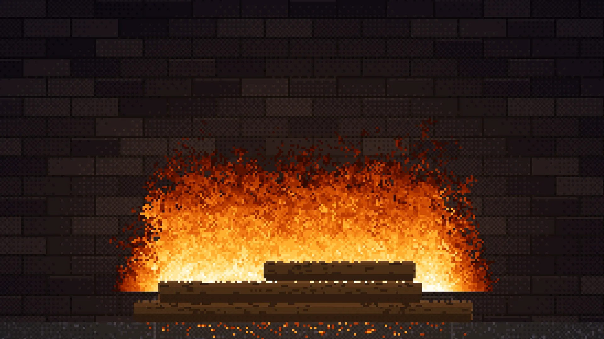

[](https://github.com/Screenly/8bit-fireplace-app/releases/latest)

# 8bit Fireplace

A full-screen 8-bit fireplace for Screenly digital signage screens — a burning
pixel-art log pile with drifting embers and firelight moving across the
firebrick behind it.

There is deliberately no drawn surround, mantel or caption: the screen's own
bezel frames the hearth, so the TV itself becomes the mantelpiece.



## How it works

The whole picture is one small canvas — around 280x155 pixels — upscaled by a
whole number of device pixels and drawn with `image-rendering: pixelated`. That
keeps every chunky pixel exactly square from 480x800 up to 4096x2160, and means
the cost per frame barely changes with the display's resolution.

- **Flames** are the classic cellular "Doom fire": heat seeded along the top of
  the log pile, spreading one row up per tick with a little random loss. It runs
  at a fixed 30 ticks per second regardless of the display's refresh rate, and
  is pre-warmed at startup so a screen never shows a cold hearth.
- **Firelight** is palette animation, not per-pixel shading. Each static pixel
  stores a colour plus how exposed it is to the fire; lighting a frame is one
  lookup per pixel against a pre-baked table. The band edges are dithered with
  an ordered 4x4 matrix so the light does not read as concentric rings.
- **Colours** come from a 16-colour scene palette and a 15-step flame ramp.
- **The logs** are composited _over_ the flames, so the fire licks up between
  them, and they are deliberately lit less than the brickwork — a pile lit to
  the same degree turns into pale sandstone rather than firewood.

The brickwork is generated from a seed derived from the screen's hostname, so
each screen gets its own firebox but always looks the same after a restart.

## Configuration

| Setting        | Description                                                     | Required | Default   |
| -------------- | --------------------------------------------------------------- | -------- | --------- |
| `crt_effect`   | Overlay CRT-style scanlines                                     | No       | `false`   |
| `flame_color`  | `classic`, `azure`, `emerald` or `violet`                       | No       | `classic` |
| `flame_height` | `low`, `medium` or `high`                                       | No       | `medium`  |
| `music`        | `shuffle` or one tune's id (see below)                          | No       | `shuffle` |
| `pixel_size`   | `chunky`, `classic` or `fine`                                   | No       | `classic` |
| `scene`        | `hearth` for the log fire, `inferno` for a full screen of flame | No       | `hearth`  |
| `sentry_dsn`   | Sentry DSN for error reporting; leave empty to disable          | No       | _(empty)_ |
| `sound`        | 8-bit background music with the seasonal themes                 | No       | `false`   |
| `theme`        | `auto`, `standard`, `halloween`, `christmas` or `new_year`      | No       | `auto`    |

With `theme` on `auto` the fireplace follows the player's local clock: Halloween
through the whole of October, Christmas from 1 to 27 December, New Year from
28 December to 6 January, and standard the rest of the year. The app checks the
date once a minute, so a screen that runs for weeks without a reload still
changes over.

The Halloween theme adds up to three jack-o'-lanterns (two on a narrow
portrait screen) with candle-lit faces on the
hearth, cobwebs in the top corners, spiders on silk, bats and the odd ghost.
Every so often a big skeleton walks in, grabs a pumpkin and runs off with it,
and another turns up a few seconds later with a different one and puts it down
somewhere new. Small skeletons scurry past on their own timer: about a third
of them pinch a pumpkin too, and the rest have an even chance of being
snatched by a big spider that drops from the top and hauls them away. The
dangling spiders take turns, climbing off and being replaced by new ones. The
pumpkin designs and the webs are rearranged on every load (the
brickwork still comes from the hostname, so the room itself stays the same),
and the critters come in random sizes. Everything is lit by the fire the same
way as the brickwork. The inferno scene has no hearth, so it gets the webs and
critters, and the skeletons only stroll past.

The Christmas and New Year themes both hang a garland of fairy lights across
the top of the firebox; the lights switch between steady, alternating, chasing
and twinkling every ten seconds or so. Christmas adds stockings hung from the
garland's bows, snow drifting down the flue and melting before it reaches the
flames, and a red Christmas rug with a gold border and a row of diamonds laid
over the hearth floor in place of the grey ash. A decorated tree stands in one corner of the
hearth. It is grown fresh on every load from drooping branches of shaded
needles, with ornaments hanging from the branch tips, a bead garland,
twinkling lights and a star that throws off the odd sparkle, and it is drawn
at the scene's own pixel size, so the fine setting gets a more detailed tree.
Every minute or so Santa's sleigh
flies across the top behind Rudolph and another reindeer, shaking off
stardust and dropping a present or two onto the hearth. A kid in striped
pyjamas keeps sneaking in from the side to grab a present, jump for joy and
run off with it over their head, always leaving at least one. New Year keeps the garland, swaps the stockings for a red banner wishing a
happy new year (the coming year from 28 December, so a screen shows the same
number either side of midnight), lays a navy-and-gold version of the rug, and
fires rockets up out of the fire to burst in the dark above it. Party guests in
paper hats stand either side of the fire (two a side, or one on a narrow
portrait hearth), each dressed differently; they bop to the music and now and
then one blows a party horn. Under the banner a dark board counts down to
midnight on New Year's Eve by the screen's own clock, in glowing gold digits:
days and a ticking clock (`3D 14:05:09`), then just the clock on the last day.
In the last ten seconds the guests stop to watch while big numbers count down
in the middle of the screen. At midnight the new year flashes up in their
place, the guests jump and cheer with their arms in the air, rockets go up
thick and fast for half a minute and a shower of confetti comes down. The
board is gone for the rest of the season, and the confetti stays on the floor
with a couple of party hats, a blower and a rattle left lying about; a screen
started after midnight finds the mess already there. The tree, presents
and stockings are rearranged on every load. The inferno scene has no hearth, so it gets the
garland, snow, the sleigh, the countdown, fireworks and falling confetti but no
tree, guests or anything else standing on the floor.

With `sound` on, the seasonal themes also play 8-bit background music,
synthesised in the browser so there are no audio files. Each theme has its own
playlist, and `shuffle` changes tune about once a minute with a short pause in
between:

| Theme     | Tunes (`music` ids)                                                                                   |
| --------- | ----------------------------------------------------------------------------------------------------- |
| Halloween | `haunted_hall`, `graveyard_waltz`, `creeping`, `toccata`                                              |
| Christmas | `jingle_bells`, `deck_the_halls`, `we_wish`, `silent_night`, `good_king_wenceslas`, `hark_the_herald` |
| New Year  | `auld_lang_syne`, plus the Christmas tunes                                                            |

All the Christmas and New Year tunes are carols or songs whose melodies are
long out of copyright (the newest, Silent Night, dates from 1818), and the
arrangements are written from scratch in this repository, so there is nothing
to license.

Pick a single tune and it loops on its own during its own season; the other
seasons still shuffle. The standard fireplace is always silent. Sound is off by
default, as most screens have no speakers. Some players only allow audio after
a click, in which case the screen simply stays silent.

An unrecognised value falls back to its default rather than blanking the screen.

The app deliberately ignores the workspace's branding colours: the palette is
fixed, and recolouring it would break the period look. Use `flame_color` to
change the mood instead.

## Use of `@screenly/edge-apps`

Settings, metadata, the ready signal, error handling, Sentry reporting, the
base reset and design tokens, the shared ESLint/Vite/Playwright tooling and the
screenshot and mock helpers all come from the library.

Two things are deliberately not used:

- **`<auto-scaler>` / `initEdgeApp()`** scale a fixed 1920x1080 reference box
  with a fractional CSS transform and letterbox whatever does not fit. That is
  right for a layout-based app and wrong for this one: it resamples the pixel
  art and leaves dead bars. Measured on a real player frame, the app's own
  integer upscale keeps 100% of pixel blocks a single flat colour, whereas the
  same frame through `<auto-scaler>` is 54% impure at 800x480 and loses 44% of
  a 1080x1920 screen to letterboxing. The app sizes its own canvas instead.
- **`base/fonts.css`** (via the `@screenly/edge-apps/styles` barrel) inlines
  ~450 kB of base64 Inter. This app renders no HTML text, so it imports the
  reset and tokens directly and ships 0.9 kB of CSS.

## Getting Started

Install dependencies:

```bash
bun install
```

## Development

```bash
bun run dev
```

## Testing

```bash
bun run test
bun run lint
```

## Build

```bash
bun run build
```

## Screenshots

```bash
bun run screenshots
```

## Deployment

```bash
screenly edge-app create --name 8bit-fireplace --in-place
bun run deploy
screenly edge-app instance create
```

Stage and production share a single `screenly.yml` with no `id`. The Edge App ID
for each environment is supplied by GitHub:

| Source                                       | Used when  |
| -------------------------------------------- | ---------- |
| `STAGE_EDGE_APP_ID` repository variable      | Stage      |
| `PRODUCTION_EDGE_APP_ID` repository variable | Production |

Run **Initialize Edge App** against stage or production to create the app, then
store the printed id in the matching variable.

**Update Edge App** starts a stage deploy on every push to `master`, and can also
be run by hand against stage. Production is deployed only by pushing a version tag
such as `v26.10.0`. Both deploys wait for approval in the GitHub `stage` and
`production` environments. To release, tag the commit on `master` and push the tag. A tag
whose commit is not on `master` is refused:

```bash
git tag v26.10.0
git push origin v26.10.0
```

Then publish a GitHub Release whose notes list the pull requests merged since
the previous release (add `--draft` to review the notes first):

```bash
gh release create v26.10.0 --verify-tag --generate-notes --title v26.10.0
```

Versions are calendar based, `vYY.M.PATCH`: the year, the month without a
leading zero, and a count of releases that month starting from 0. A second
release in October 2026 is `v26.10.1`.

Restrict the GitHub `production` environment to tags matching `v[0-9]*`
(Settings → Environments → Deployment branches and tags) so only a tagged
release can reach it.
